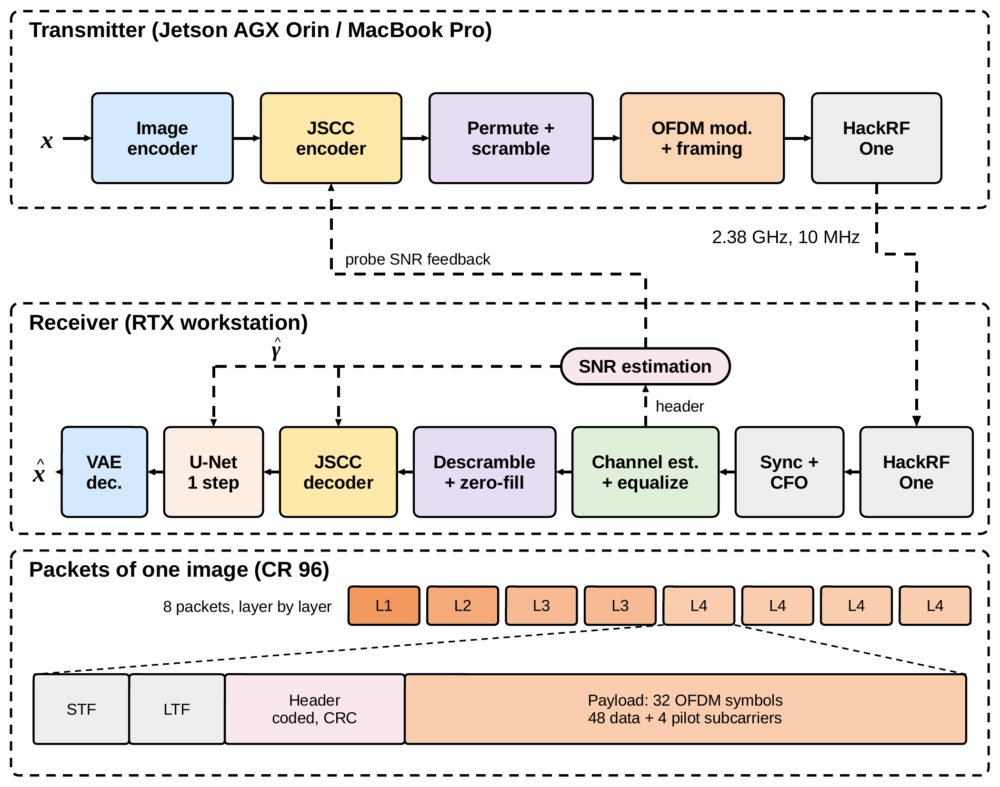

# OSD-JSCC-P over HackRF

Real-time image transmission using an NVIDIA Jetson AGX Orin, two HackRF One
radios, and an RTX PRO 6000 receiver. The Orin encodes camera frames with a
TensorRT sender, an OFDM link carries the learned symbols over the air, and
the RTX reconstructs images with a JSCC decoder, one SD-Turbo U-Net step and a
compact image decoder. A browser displays the live reconstruction.

The transmitter and receiver also need a TCP connection for session control,
timestamps, SNR feedback and the reference preview. In RF mode, **the learned
symbols used for reconstruction travel over HackRF**, not over TCP. The
receiver estimates SNR from the signal; lost packets are zero-filled.

The six progressive compression ratios are 768, 384, 192, 96, 64 and 48.
The released compact sender and image decoder are the Tiny variant; the JSCC
receiver and U-Net are derived from the published [OSD-JSCC-P
weights](https://github.com/tangshunpu/OSD-JSCC/tree/main/osd_jscc_p).

## System deployment


The illustrated prototype uses a HackRF One at each end. This repository
provides the Jetson AGX Orin transmitter and RTX workstation receiver shown
above. [Download the original figure (PDF)](assets/system_deployment.pdf).

## Transmission pipeline and OFDM frame



For a 512×768 image at CR 96, the four transmitted layers occupy eight
packets. Each packet contains short and long training fields (STF and LTF), a
coded header with CRC, and 32 payload OFDM symbols with 48 data and 4 pilot
subcarriers each. [Download the original figure (PDF)](assets/ofdm_frame_and_pipeline.pdf).

## Hardware and software

- Jetson AGX Orin with a USB camera, a HackRF One, JetPack and TensorRT.
- NVIDIA RTX PRO 6000 with a second HackRF One, CUDA, TensorRT and PyTorch.
- A network connection between the devices and a browser on that network.
- Python 3.12, Git LFS, C++ compiler, `hackrf_transfer` and libhackrf. On both
  Ubuntu devices, `sudo apt install hackrf libhackrf-dev g++` provides the
  radio tools and libraries. Verify access with `hackrf_info`.

Tested with JetPack R39.2.1 / TensorRT 10.16.2 on the Orin and TensorRT
10.16.1 / CUDA 13 on the RTX. TensorRT engines are hardware- and
version-specific: build each engine on the machine that will run it. The
default example uses 512×768; the repository also includes the compact Orin
sender graph for 768×1280 (padded 720p).

## Set up

Clone with Git LFS on both machines. The compact sender and decoder ONNX
weights are tracked with LFS; generated TensorRT engines are not.

```bash
git lfs install
git clone https://github.com/tangshunpu/OSD-JSCC-HackRF.git
cd OSD-JSCC-HackRF
git lfs pull
```

On the Orin, use JetPack's TensorRT Python bindings and install Python
dependencies suitable for its JetPack environment: NumPy, SciPy, Pillow and
OpenCV. On the RTX, install PyTorch with CUDA, torchvision, diffusers,
transformers, accelerate, peft, safetensors, NumPy, SciPy, Pillow, OpenCV,
ONNX and TensorRT. For the tested CUDA 13 / Python 3.12 RTX configuration,
the relevant versions are PyTorch 2.11, diffusers 0.39, ONNX 1.19.1 and
TensorRT 10.16.1. Select packages compatible with the installed NVIDIA driver.

The RTX also needs the released OSD-JSCC-P checkpoint and SD-Turbo. One way to
obtain just that LFS checkpoint is:

```bash
GIT_LFS_SKIP_SMUDGE=1 git clone https://github.com/tangshunpu/OSD-JSCC.git /tmp/osd-jscc-model
git -C /tmp/osd-jscc-model lfs pull --include='checkpoints/osd_jscc_p_awgn.safetensors'
mkdir -p checkpoints
cp /tmp/osd-jscc-model/checkpoints/osd_jscc_p_awgn.safetensors checkpoints/
```

SD-Turbo is downloaded or read from the Hugging Face cache on first export;
use `--sd-model /path/to/sd-turbo` for a local copy.

## Build the engines

Run commands from the repository root. On the **RTX**, export the two shared
receiver graphs from the public checkpoint, then build the three receiver
engines. Export needs substantial disk space for the SD-Turbo U-Net graph.

```bash
python experiments/deploy/export_onnx.py --parts rx_jscc unet_step
python experiments/deploy/build_engine.py --graph rx_jscc --size 512x768 --tag rtx6000
python experiments/deploy/build_engine.py --graph unet_step --size 512x768 --tag rtx6000
python experiments/deploy/build_engine.py --graph vae_decode --size 512x768 \
  --root runs/taesd/tiny_deploy \
  --out runs/deploy/osd_jscc_p/engines/rtx6000/vae_decode_512x768_fp16_tiny.plan
```

On the **Orin**, build the sender engine locally:

```bash
python3 experiments/deploy/build_engine.py --graph sender --size 512x768 \
  --root runs/taesd/tiny_deploy \
  --out runs/deploy/osd_jscc_p/engines/agx_orin/sender_512x768_fp16_tiny.plan
```

For 720p video, build all four engines with `--size 768x1280`, adjust the
output filenames accordingly, and use the matching `--sizes` / `--size` on
the receiver and sender. The 768×1280 sender graph uses ONNX GroupNormalization
to avoid a TensorRT 10.16.2 Orin build failure.

## Run the live link

Find each radio's serial with `hackrf_info`. Start the receiver on the RTX:

```bash
python experiments/deploy/live_receiver.py --link rf --rx-serial <RX_SERIAL>
```

Then start the sender on the Orin, substituting the receiver's address and the
transmitter radio's serial:

```bash
python3 experiments/deploy/live_sender.py --host <RTX_IP> --link rf \
  --tx-serial <TX_SERIAL> --camera /dev/video0 --camera-size 1280 720 --no-mirror
```

Open `http://<RTX_IP>:8777` to view the stream and select a rate. `--link wifi`
on both commands runs a network link with simulated AWGN instead. Select a
permitted RF frequency and suitable gain for the local setup with `--rf-hz`,
`--tx-gain`, `--lna` and `--vga`; both endpoints must use the same frequency.

## Verification

The PHY tests run without a radio or GPU:

```bash
python -m unittest experiments/deploy/test_ofdm_phy.py
```

`experiments/deploy/` contains the Orin sender, RTX receiver, control protocol,
OFDM PHY, native HackRF/C++ helpers and TensorRT build/runtime code. The
released compact ONNX graphs derive from [TAESD](https://github.com/madebyollin/taesd)
and the OSD-JSCC-P model. SD-Turbo and derived weights are subject to the
[Stability AI Community License](https://huggingface.co/stabilityai/sd-turbo/blob/main/LICENSE.md);
TAESD is MIT licensed.
