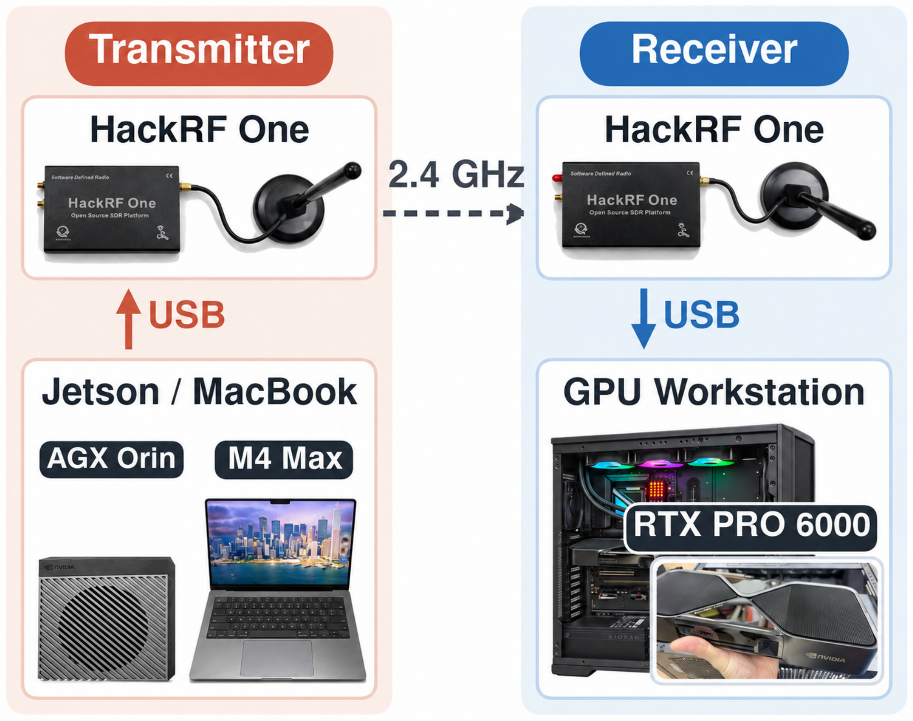

# OSD-JSCC SDR

SDR implementation of [OSD-JSCC](https://github.com/tangshunpu/OSD-JSCC), using the OSD-JSCC-P model with a Jetson AGX Orin transmitter, two HackRF One radios, and an RTX PRO 6000 receiver.

The Orin encodes images with TensorRT; HackRF transmits the JSCC symbols over OFDM; the RTX reconstructs them with one diffusion step. TCP carries control, SNR feedback, timestamps and a reference preview. Progressive transmission supports CR 768, 384, 192, 96, 64 and 48.

## System deployment



[PDF](assets/system_deployment.pdf) · The code in this repository supports the Orin transmitter and RTX receiver.

## OFDM frame


[PDF](assets/ofdm_frame_and_pipeline.pdf) · A 512×768 image at CR 96 uses eight packets. Each packet contains STF, LTF, a coded CRC header and 32 payload OFDM symbols (48 data and 4 pilot subcarriers each).

## Requirements

- **Orin:** JetPack, TensorRT, NumPy, SciPy, Pillow and OpenCV.
- **RTX:** CUDA, TensorRT, PyTorch, torchvision, diffusers, transformers, accelerate, peft, safetensors, NumPy, SciPy, Pillow, OpenCV and ONNX.
- **Both:** Python 3.12, Git LFS, C++ compiler and HackRF tools: `sudo apt install hackrf libhackrf-dev g++`. Check each radio with `hackrf_info`.

Tested with JetPack R39.2.1 / TensorRT 10.16.2 on Orin and CUDA 13 / TensorRT 10.16.1, PyTorch 2.11, diffusers 0.39 and ONNX 1.19.1 on RTX. Build TensorRT engines on their target devices.

## Setup

Clone on both devices:

```bash
git lfs install
git clone https://github.com/tangshunpu/OSD-JSCC-HackRF.git
cd OSD-JSCC-HackRF
git lfs pull
```

On the RTX, download the OSD-JSCC-P checkpoint:

```bash
GIT_LFS_SKIP_SMUDGE=1 git clone https://github.com/tangshunpu/OSD-JSCC.git /tmp/osd-jscc-model
git -C /tmp/osd-jscc-model lfs pull --include='checkpoints/osd_jscc_p_awgn.safetensors'
mkdir -p checkpoints
cp /tmp/osd-jscc-model/checkpoints/osd_jscc_p_awgn.safetensors checkpoints/
```

The export loads SD-Turbo from the Hugging Face cache or Hub. For a local copy, pass `--sd-model /path/to/sd-turbo`.

## Build engines

From the repository root, on the **RTX**:

```bash
python experiments/deploy/export_onnx.py --parts rx_jscc unet_step
python experiments/deploy/build_engine.py --graph rx_jscc --size 512x768 --tag rtx6000
python experiments/deploy/build_engine.py --graph unet_step --size 512x768 --tag rtx6000
python experiments/deploy/build_engine.py --graph vae_decode --size 512x768 \
  --root runs/taesd/tiny_deploy \
  --out runs/deploy/osd_jscc_p/engines/rtx6000/vae_decode_512x768_fp16_tiny.plan
```

On the **Orin**:

```bash
python3 experiments/deploy/build_engine.py --graph sender --size 512x768 \
  --root runs/taesd/tiny_deploy \
  --out runs/deploy/osd_jscc_p/engines/agx_orin/sender_512x768_fp16_tiny.plan
```

For padded 720p, build the four engines at `768x1280` and set the corresponding `--sizes` / `--size` at runtime. The included Orin graph uses GroupNormalization for TensorRT 10.16.2 compatibility.

## Run

Start the receiver on the **RTX**:

```bash
python experiments/deploy/live_receiver.py --link rf --rx-serial <RX_SERIAL>
```

Start the sender on the **Orin**:

```bash
python3 experiments/deploy/live_sender.py --host <RTX_IP> --link rf \
  --tx-serial <TX_SERIAL> --camera /dev/video0 --camera-size 1280 720 --no-mirror
```

Open `http://<RTX_IP>:8777`. Set the same `--rf-hz` on both devices and adjust `--tx-gain`, `--lna` and `--vga` for the setup. Use `--link wifi` on both sides to test with simulated AWGN.

## Test

```bash
python -m unittest experiments/deploy/test_ofdm_phy.py
```

The compact ONNX models use [TAESD](https://github.com/madebyollin/taesd) and OSD-JSCC-P weights. SD-Turbo and derived weights are subject to the [Stability AI Community License](https://huggingface.co/stabilityai/sd-turbo/blob/main/LICENSE.md); TAESD is MIT licensed.
